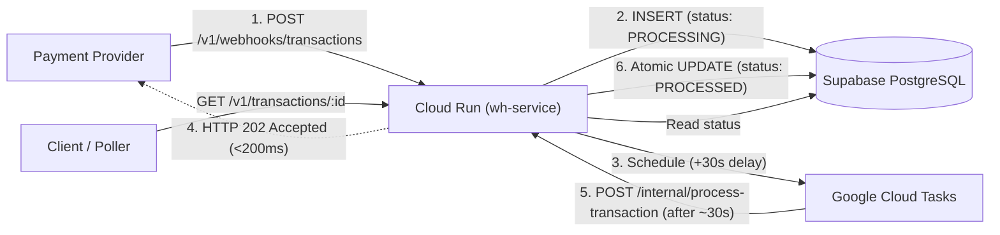

# Transaction Webhook Service

A lightweight, idempotent backend service built with **Node.js**, **TypeScript**, **Express**, **Supabase PostgreSQL**, **Google Cloud Tasks**, and **Google Cloud Run**.

---

## 1. System Design

The service handles webhook ingestion, persists the transaction, schedules background processing ~30 seconds in the future via Cloud Tasks, and returns `202 Accepted` promptly without blocking.



### Why this architecture?
- **Serverless & Scales to Zero**: Single Express app deployed to Cloud Run. No permanent workers, Redis, or BullMQ needed.
- **Durable Scheduling**: Cloud Tasks guarantees at-least-once delivery, retry backoff, and precise execution timing.
- **Relational Integrity**: Supabase PostgreSQL enforces uniqueness and atomic state transitions.

---

## 2. API Endpoints

| Endpoint | Method | Auth | Description |
| :--- | :--- | :--- | :--- |
| `/` | `GET` | Public | Health check (`{"status": "HEALTHY", "current_time": "..."}`) |
| `/v1/webhooks/transactions` | `POST` | Public | Ingests webhook, saves record, schedules 30s task, returns `202` |
| `/v1/transactions/:id` | `GET` | Public | Returns transaction status (`PROCESSING` or `PROCESSED`) |
| `/internal/process-transaction` | `POST` | OIDC / Bearer | Invoked by Cloud Tasks to mark transaction `PROCESSED` |

### Transaction Lifecycle
- `PROCESSING`: Webhook received and persisted (`processed_at: null`).
- `PROCESSED`: Settled by Cloud Tasks handler approximately 30 seconds later (`processed_at` populated).

---

## 3. Idempotency & Concurrency

1. **Duplicate Webhooks**: `transaction_id` is the database `PRIMARY KEY`. Duplicate insertions fail with error `23505`. If already scheduled or processed, returns `202 Accepted` immediately without enqueuing duplicate tasks.
2. **Concurrent Webhook Bursts**: Deduplicated via deterministic Cloud Tasks task names (`tasks/txn-<id>`), ensuring only one task is enqueued even under parallel bursts.
3. **Duplicate Task Deliveries**: Handled via atomic SQL conditional update:
   ```sql
   UPDATE transactions
   SET status = 'PROCESSED', processed_at = NOW()
   WHERE transaction_id = $1 AND status = 'PROCESSING';
   ```
   If already processed, returns `200 OK` without re-processing.
4. **Task Scheduling Failures**: If Cloud Tasks fails after DB insert, the API returns `503 Service Unavailable` with `is_scheduled = false`. Subsequent webhook retries detect the record and recover the task creation.

---

## 4. Local Development & Testing

```bash
# 1. Install dependencies
npm install

# 2. Run test suite (14 automated tests in-memory)
npm test

# 3. Type check & build
npm run typecheck
npm run build

# 4. Start local development server
npm run dev
```

---

## 5. Environment Variables

| Variable | Description |
| :--- | :--- |
| `PORT` | Server port (default: `8080`) |
| `NODE_ENV` | `production` / `development` / `test` |
| `SUPABASE_URL` | Supabase project URL |
| `SUPABASE_SERVICE_ROLE_KEY` | Supabase secret/service role key |
| `GCP_PROJECT_ID` | Google Cloud project ID |
| `CLOUD_TASKS_QUEUE` | Cloud Tasks queue name (e.g. `transaction-tasks`) |
| `CLOUD_TASKS_LOCATION` | Cloud Tasks region (e.g. `asia-south1`) |
| `CLOUD_RUN_SERVICE_URL` | Public HTTPS URL of the deployed Cloud Run service |
| `CLOUD_TASKS_SERVICE_ACCOUNT_EMAIL` | Service account for OIDC authentication |
| `INTERNAL_AUTH_TOKEN` | Secret token for dev/direct test invocation |

---

## 6. Deployment to Google Cloud Run

Deploy directly from source via Google Cloud SDK:

```bash
gcloud run deploy wh-service \
  --source . \
  --region=asia-south1 \
  --platform=managed \
  --allow-unauthenticated \
  --min-instances=0 \
  --max-instances=10 \
  --set-env-vars="\
NODE_ENV=production,\
SUPABASE_URL=https://your-project.supabase.co,\
SUPABASE_SERVICE_ROLE_KEY=your-secret-key,\
GCP_PROJECT_ID=your-project-id,\
CLOUD_TASKS_QUEUE=transaction-tasks,\
CLOUD_TASKS_LOCATION=asia-south1,\
CLOUD_RUN_SERVICE_URL=https://wh-service-REPLACE_ME.asia-south1.run.app,\
CLOUD_TASKS_SERVICE_ACCOUNT_EMAIL=cloud-tasks-invoker@your-project-id.iam.gserviceaccount.com"
```

Grant Cloud Run Invoker permission to your service account:
```bash
gcloud run services add-iam-policy-binding wh-service \
  --region=asia-south1 \
  --member="serviceAccount:cloud-tasks-invoker@your-project-id.iam.gserviceaccount.com" \
  --role="roles/run.invoker"
```

---

## 7. Live Testing (cURL & Postman)

A pre-configured Postman Collection is included at [`postman_collection.json`](./postman_collection.json).

```bash
URL="https://wh-service-1030321645310.asia-south1.run.app"

# 1. Health check
curl -X GET "$URL/"

# 2. Ingest transaction webhook (returns 202 in <200ms)
curl -X POST "$URL/v1/webhooks/transactions" \
  -H "Content-Type: application/json" \
  -d '{"transaction_id":"txn_demo_01","source_account":"acc_1","destination_account":"acc_2","amount":1500,"currency":"INR"}'

# 3. Check status immediately (status: PROCESSING, processed_at: null)
curl -X GET "$URL/v1/transactions/txn_demo_01"

# 4. Check status after 35 seconds (status: PROCESSED, processed_at: populated)
curl -X GET "$URL/v1/transactions/txn_demo_01"
```
