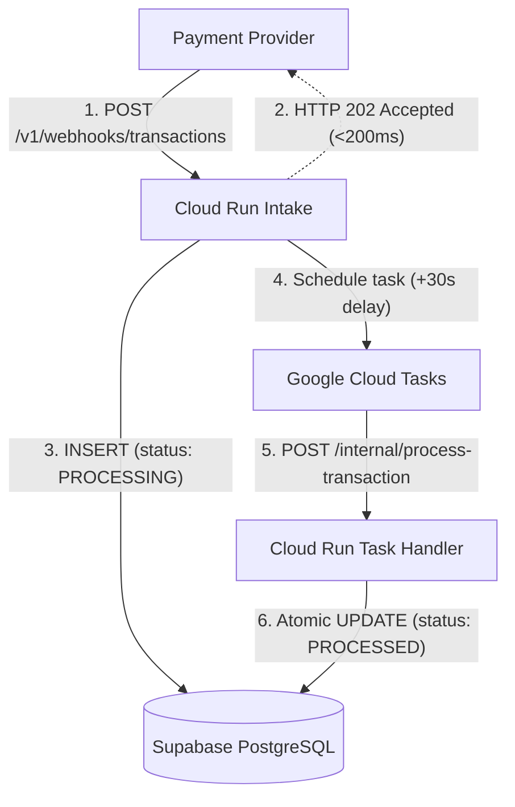

# Transaction Webhook Service

A lightweight, idempotent backend service built with TypeScript, Express, Supabase PostgreSQL, Google Cloud Tasks, and Google Cloud Run.

---

## Architecture



---

## Endpoints

- `GET /` — Health check
- `POST /v1/webhooks/transactions` — Ingest transaction webhook (returns `202 Accepted`)
- `GET /v1/transactions/:id` — Retrieve transaction status (`PROCESSING` $\rightarrow$ `PROCESSED`)
- `POST /internal/process-transaction` — Cloud Tasks worker endpoint

---

## Quick Start

```bash
# Install dependencies
npm install

# Run automated tests
npm test

# Run locally
npm run dev
```

---

## Live Verification

**Base URL**: `https://wh-service-1030321645310.asia-south1.run.app`

```bash
# 1. Health check
curl https://wh-service-1030321645310.asia-south1.run.app/

# 2. Ingest transaction webhook
curl -X POST https://wh-service-1030321645310.asia-south1.run.app/v1/webhooks/transactions \
  -H "Content-Type: application/json" \
  -d '{"transaction_id":"txn_demo_01","source_account":"acc_1","destination_account":"acc_2","amount":1500,"currency":"INR"}'

# 3. Check status immediately (status: PROCESSING)
curl https://wh-service-1030321645310.asia-south1.run.app/v1/transactions/txn_demo_01

# 4. Check status after 35s (status: PROCESSED)
curl https://wh-service-1030321645310.asia-south1.run.app/v1/transactions/txn_demo_01
```

*(A Postman collection is also available at [`postman_collection.json`](./postman_collection.json)).*
